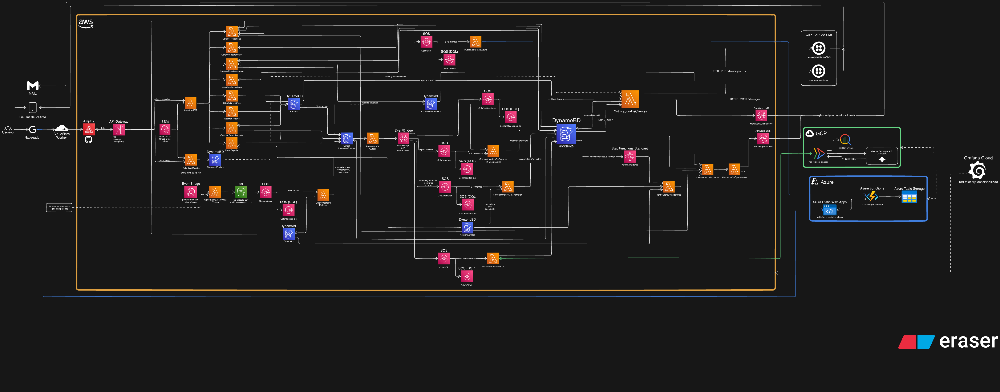

# Red TeleCorp

Gestión de incidencias y monitoreo de antenas de una operadora. Núcleo serverless en **AWS** (Academy), con **GCP** (BigQuery, Cloud Run, Gemini), **Azure** (Functions, Static Web Apps), **Grafana Cloud** y **Twilio**. Portal en Amplify detrás de un Worker de Cloudflare.



## Flujo

1. Los clientes crean reportes. 10 clientes distintos en la misma zona y servicio en menos de 24 h abren un incidente (`EVALUACION`).
2. Cada minuto un simulador genera GB/min de 30 antenas. Una anomalía abre un episodio y se vincula al incidente de su zona.
3. Step Functions (`VerificarIncidente`) revisa la evidencia, calcula la prioridad (P1 a P3) y alerta a operaciones.
4. Los clientes reciben aviso por correo (SNS) o SMS (Twilio) en `EVALUACION`, `CONFIRMADO` y `RESTABLECIDO`.
5. Operaciones restablece y cierra desde el portal. La IA (Gemini) solo sugiere.

Todo evento sale por la tabla `Outbox` en la misma transacción que el dato.

## Carpetas

| Carpeta | Contenido |
|---|---|
| `aws/` | Lambdas (`src/handlers`), código común (`src/common`), infraestructura (`serverless.yml`, `infra/`) y pruebas con moto. |
| `scripts/` | SSM, datos de demo, prueba de humo, escenarios y carga. |
| `gcp/` | Cloud Run, BigQuery y Gemini (Terraform). |
| `azure/` | Página pública de estado. |
| `frontend/cliente/` | Portal React de clientes y operadores. |
| `grafana/` | Dashboard. |
| `arquitectura/` | Diagramas. |

## Uso

Requiere Python 3.11, Node 18 y credenciales de AWS Academy (`us-east-1`, rol `LabRole`).

```bash
# pruebas (sin credenciales)
cd aws && python -m pip install -r requirements-dev.txt && python -m pytest

# despliegue, desde la raíz
python scripts/bootstrap_ssm.py --stage dev --from-address correo-verificado@dominio.com
cd aws && npm install && npm run deploy && cd ..
SEED_DEMO_PASSWORD='<clave>' python scripts/seed.py --stage dev
python scripts/smoke.py --base-url https://<id>.execute-api.us-east-1.amazonaws.com
```

**Desde cero, en otra cuenta (sin GCP, Azure, Grafana ni Twilio):** el `flags.yml` del repo es el de nuestro despliegue. Antes de `npm run deploy` déjalo así:

```yaml
external: false
azure: false
grafana: false
emailMode: SIMULATED
smsMode: SIMULATED
opsEmail: ''
```

Cada integración se activa después: carga sus claves con `python scripts/bootstrap_ssm.py --only <clave> --value-env VARIABLE --force`, pon su flag en `true` y vuelve a desplegar. Los secretos viven solo en SSM. Detalles de [Azure](azure/README.md) y del [portal](frontend/cliente/README.md).
