# Red TeleCorp

Gestión de incidencias y monitoreo de antenas de una operadora de telecomunicaciones.
El núcleo corre en **AWS** (serverless, costo mínimo, AWS Academy). **GCP** aporta analítica e IA y **Azure** una página pública de estado.



Más diagramas en [arquitectura/](arquitectura/): [vista interactiva](arquitectura/arquitectura-solucion-v4.html), [diagrama del equipo](arquitectura/arquitectura-solucion-propuesta-equipo.png), [flujo del incidente](arquitectura/flujo-incidente-v4.svg) y [flujo de comunicación](arquitectura/flujo-comunicacion-v4.svg).

## Cómo funciona

1. **Reportes de clientes.** Un cliente inicia sesión y crea un reporte (`REGISTRADA`). El reporte y su evento se guardan en una sola transacción.
2. **Incidente colectivo.** Cuando **10 clientes distintos** reportan la misma zona y servicio en menos de 24 h, se abre un incidente en `EVALUACION`. No exige que haya una antena caída.
3. **Telemetría.** Cada minuto un simulador genera una lectura de GB/min por cada una de las 30 antenas. Una anomalía abre un episodio y cinco lecturas normales seguidas lo cierran. Tres episodios en 7 días marcan recurrencia.
4. **Correlación.** Un episodio de antena se vincula al incidente de su zona, o crea uno nuevo. La recuperación técnica es evidencia: no cierra ni restablece nada por sí sola.
5. **Verificación y prioridad.** Una máquina de estados (Step Functions) revisa las evidencias, calcula la prioridad (P1, P2, P3), puede confirmar el incidente y alerta al equipo por correo de texto.
6. **Comunicación.** Al pasar por `EVALUACION`, `CONFIRMADO` o `RESTABLECIDO`, cada cliente vinculado recibe un aviso por el canal con consentimiento (una sola vez por cliente e hito).
7. **Operación.** Los operadores cambian el estado de reportes e incidentes, ven la cola por prioridad, las tendencias y una sugerencia de IA.

Los eventos nunca se publican directo: se escriben en la tabla `Outbox` dentro de la misma transacción que el dato, y una Lambda los lleva al bus de EventBridge.

## Estructura del repositorio

| Carpeta | Contenido |
|---|---|
| `aws/src/handlers/` | Una Lambda por archivo, función `handler(event, context)`. |
| `aws/src/common/` | Código compartido: `config`, `ids`, `ddb`, `events`, `http`, `auth`, `domain` (reglas de negocio), `pii`, `outbound`, `jsonutil`. |
| `aws/serverless.yml`, `aws/infra/` | Infraestructura (Serverless Framework v3): funciones, tablas, colas, bus, máquina de estados y flags. |
| `aws/tests/` | Pruebas con `moto`, sin tocar AWS real. |
| `scripts/` | Parámetros SSM, datos de demo, prueba de humo, escenarios y prueba de carga. |
| `gcp/` | Cloud Run (`/ingest`, `/suggest`), BigQuery y Gemini, con Terraform. |
| `azure/` | Reservada para la página de estado (Functions y Static Web Apps). |
| `frontend/cliente/` | Portal React de clientes y operadores; desarrollo local y configuración de Amplify en [su README](frontend/cliente/README.md). |
| `arquitectura/` | Diagramas de la solución. |

## Requisitos

- Python 3.11 o superior (las Lambdas usan 3.11).
- Node.js 18 o superior (para Serverless Framework v3).
- Credenciales de AWS Academy (`AWS_ACCESS_KEY_ID`, `AWS_SECRET_ACCESS_KEY`, `AWS_SESSION_TOKEN`) en la región `us-east-1`. Caducan al reiniciar el lab: hay que volver a pegarlas. Todo usa el rol `LabRole`.

## Pruebas locales

```bash
cd aws
python -m pip install -r requirements-dev.txt
python -m pytest
ruff check src tests
```

No necesitan credenciales de AWS. En Windows, si `make` no existe, usa estos comandos directos.

## Despliegue en AWS

Desde la raíz del repositorio, con las credenciales de Academy ya definidas en el entorno.

```bash
# 1. Dependencias de los scripts y de Serverless
python -m pip install -r aws/requirements-dev.txt
cd aws && npm install && cd ..

# 2. Parámetros SSM (clave JWT y sal de privacidad se generan solas; los de GCP y Azure quedan en
#    PENDIENTE hasta que existan; no pisa lo que ya existe)
python scripts/bootstrap_ssm.py --stage dev --from-address correo-verificado@dominio.com

# 3. Desplegar (tablas, colas, bus, Lambdas, API, máquina de estados)
cd aws && npm run deploy && cd ..

# 4. Datos de demo: 12 zonas, 30 antenas, 1 operador y 20 clientes ficticios
export SEED_DEMO_PASSWORD='<clave de demo>'      # PowerShell: $env:SEED_DEMO_PASSWORD = "<clave de demo>"
python scripts/seed.py --stage dev

# 5. Prueba de humo contra la URL que imprimió el despliegue
python scripts/smoke.py --base-url https://<id>.execute-api.us-east-1.amazonaws.com
```

Para quitar todo: `cd aws && npm run remove`. La clave de demo se lee solo de la variable de entorno y nunca se imprime ni se guarda.

### Interruptores (`aws/infra/flags.yml`)

Se editan y se vuelve a desplegar.

| Flag | Valor | Efecto |
|---|---|---|
| `external` | `false` | `true` activa las reglas y colas hacia GCP y Azure. |
| `emailMode` | `SIMULATED` | `SES` envía correos reales (hay que verificar remitentes en SES). |
| `smsMode` | `SIMULATED` | `SNS` envía SMS reales (depende de los permisos de la cuenta). |
| `generator` | `true` | `false` pausa el simulador de antenas y ahorra créditos. |
| `grafana` | `true` | `false` deja de enviar métricas a Grafana Cloud (cada 5 minutos). |
| `opsEmail` | correo | Suscripción de las alertas internas del equipo. Vacío = sin suscripción. |
| `pitr` | `true` | Recuperación punto en el tiempo en DynamoDB (35 días de retención). |

Con `SIMULATED` el envío solo se registra en la tabla `Incidents` (`NOTIFY`), sin llamar a SES ni a SNS.

## Scripts de demo y prueba

| Script | Uso |
|---|---|
| `scripts/smoke.py` | Login, crear reporte (con idempotencia), listar, consultar e incidente colectivo con 10 clientes. |
| `scripts/scenario.py` | `activar --antena A004=0 --minutos 10`, `ver`, `limpiar`: fuerza fallas en antenas. A004 pertenece a Z02. Cada antena necesita 5 lecturas normales seguidas para cerrar su episodio. |
| `scripts/load_test.py` | `--zona Z05 -n 30`: N reportes (1 hilo por defecto, máximo 4), con latencia p50, p95 y máxima. Detalle de opciones en el encabezado del script. |
| `scripts/seed.py` | Datos de demo, idempotente. `--force` reescribe perfiles. |
| `scripts/bootstrap_ssm.py` | Crea los parámetros SSM. `--only gcp/base_url --value https://... --force` actualiza uno. |

Operador de demo: `OP001`. Clientes de demo: `70000001` a `70000020`.

## Portal de servicio

La aplicación en [`frontend/cliente/`](frontend/cliente/README.md) sirve a **clientes y operadores** según el rol devuelto por el login. Los clientes crean y siguen reportes y consultan el estado de su zona. Los operadores revisan la cola por prioridad, el detalle y el historial de incidentes, los reportes por zona, las tendencias y las sugerencias de IA bajo demanda; pueden cambiar estados con motivo y confirmación. Las consultas principales se probaron contra el API de `dev` con cuentas ficticias. El [`amplify.yml`](amplify.yml) prepara una sola aplicación Amplify para ambos roles. **Falta** crear o publicar la aplicación en Amplify y validar desde su dominio los cambios de estado, la creación de reportes, la paginación y el vencimiento de sesión. Cloudflare delante del portal continúa pendiente.

## API (API Gateway HTTP API)

Autenticación con `Authorization: Bearer <jwt>` en todas las rutas salvo `/auth/login`. Roles `CUSTOMER` y `OPERATOR`. Las listas paginan con `?limit=` (20 por defecto, 100 máximo) y `?cursor=`. Errores con el formato `{"error":{"code","message"}}` (`VALIDATION` 400, `UNAUTHORIZED` 401, `FORBIDDEN` 403, `NOT_FOUND` 404, `CONFLICT` 409, `INTERNAL` 500).

| Ruta | Acceso | Qué hace |
|---|---|---|
| `POST /auth/login` | público | Devuelve un JWT de 15 minutos. |
| `GET /zonas` | cualquiera | Zonas disponibles. |
| `POST /reportes` | CUSTOMER | Crea un reporte. Acepta `Idempotency-Key`: repetirla devuelve 200 con el original. |
| `GET /reportes` | CUSTOMER / OPERATOR | Los propios, o por `?zone_id=` para el operador. |
| `GET /reportes/{id}` | dueño u OPERATOR | Detalle con historial. |
| `PATCH /reportes/{id}/estado` | OPERATOR | Cambia el estado (`to_status`). |
| `GET /incidentes` | cualquiera / OPERATOR | `?zone_id=`: vista pública sin incidentes `CERRADO`. `?status=`: cola por prioridad (operador). |
| `GET /incidentes/{id}` | OPERATOR | Detalle, historial y vínculos. |
| `PATCH /incidentes/{id}/estado` | OPERATOR | Cambia el estado. |
| `GET /incidentes/{id}/sugerencia` | OPERATOR | Hipótesis de IA desde GCP. Si GCP falla o tarda más de 4 s responde `{"available":false}`, nunca 5xx. |
| `GET /tendencias?days=30` | OPERATOR | Top de zonas, antenas y tipos de problema, antenas recurrentes y calidad de detección. |

## Estados y reglas de negocio

Las reglas viven solo en `aws/src/common/domain.py`.

- **Antena (GB/min):** 0 inhabilitada, menos de 60 caída, más de 129 saturada, de 60 a 129 normal.
- **Reporte:** `REGISTRADA → EN_REVISION → EN_ATENCION → SOLUCIONADA → CERRADA`, con reapertura `SOLUCIONADA → EN_ATENCION`.
- **Incidente:** `EVALUACION → CONFIRMADO → RESTABLECIDO → CERRADO`, más `EVALUACION → CERRADO` (falso positivo) y `RESTABLECIDO → CONFIRMADO` (reabrir). El sistema solo confirma con evidencia técnica; restablecer y cerrar lo hace el operador.
- **Prioridad:** P1, P2 o P3 según la criticidad de la zona (residencial 1, industrial 2, educativa 3, médica 4, crítica 5) y los clientes afectados. Los umbrales de 100 y 1000 clientes reevalúan la prioridad.

## Lambdas

| Grupo | Lambdas |
|---|---|
| API | `AutenticarUsuario`, `AutorizarJWT`, `ListarZonas`, `CrearReporte`, `ListarMisReportes`, `ObtenerReporte`, `CambiarEstadoReporte`, `ListarIncidentesZona`, `CambiarEstadoIncidente`, `ObtenerTendencias`, `ObtenerSugerenciaIA` |
| Telemetría | `GeneradoraDeMetricasYLotes` (cada minuto), `ClasificadoraDeMetricas`, `CorrelacionadoraDeAnomalias` |
| Incidentes | `CorrelacionadoraDeReportes`, `VerificadoraDeEvidencias`, `CalculadoraDePrioridad`, `AlertadoraDeOperaciones` (las tres últimas dentro de la máquina `VerificarIncidente`) |
| Eventos | `EnrutadoraDeOutbox` (única que llama a `PutEvents`), `NotificadoraDeClientes`, `PublicadoraHaciaGCP`, `PublicadoraHaciaAzure` |
| Observabilidad | `PublicadoraHaciaGrafana` (cada 5 minutos) |

Todas con Python 3.11, solo biblioteca estándar y `boto3`, 256 MB y rol `LabRole`. Los handlers de colas son idempotentes (SQS entrega al menos una vez) y devuelven `batchItemFailures`. Cada cola tiene una DLQ tras 3 reintentos.

## Modelo de datos (DynamoDB)

Siete tablas `red-telecorp-<stage>-<Tabla>`, pago por uso, con claves genéricas `pk`/`sk` y varias entidades por tabla (atributo `type`). Fechas ISO-8601 UTC con milisegundos; números `int` o `Decimal`. El espejo para pruebas está en `aws/tests/schema.py`.

| Tabla | Entidades | Índices |
|---|---|---|
| `Reports` | `REPORT_META`, `REPORT_HIST`, `IDEMPOTENCY` | por cliente, por zona |
| `Incidents` | `INCIDENT_META`, `INCIDENT_HIST`, `LINK_REPORT`, `LINK_USER`, `LINK_ANTENNA`, `NOTIFY` | por zona, por estado y prioridad |
| `Telemetry` | `ANTENNA_LAST`, `EPISODE` | por zona, episodios abiertos |
| `CorrelationMembers` | `MEMBER` (clientes por grupo zona-servicio), `ACTIVE_INCIDENT` (puntero que evita duplicados) | — |
| `NetworkCatalog` | `ZONE`, `ANTENNA`, `SCENARIO` | por tipo, por zona |
| `CustomerProfiles` | `CUSTOMER`, `OPERATOR` (datos personales, no salen de AWS) | — |
| `Outbox` | eventos pendientes de publicar (Stream) | — |

Todo cambio de estado es una transacción que actualiza el `META` con `version`, agrega un `HIST` y escribe el evento en `Outbox`.

## Eventos

Sobre estándar `{"event_id","type","version","occurred_at","data"}` en el bus `red-telecorp-<stage>-operaciones`.

| Evento | Lo produce | Destinos |
|---|---|---|
| `report.created` | CrearReporte | ColaReportes, ColaGCP |
| `report.status_changed` | CambiarEstadoReporte | ColaGCP |
| `report.linked` | CorrelacionadoraDeReportes | ColaNotificaciones, ColaGCP |
| `telemetry.anomaly`, `telemetry.recovered`, `telemetry.recurrent` | ClasificadoraDeMetricas | ColaAnomalias, ColaGCP |
| `incident.updated` | correlacionadoras, calculadora de prioridad, cambio de estado | verificación (Step Functions), notificaciones, GCP y Azure |

La verificación se dispara con `change` en `CREATED`, `EVIDENCE`, `THRESHOLD` y `RECOVERY`. `PRIORITY` y `STATUS` no la disparan, para evitar bucles.

## Observabilidad (Grafana Cloud)

`PublicadoraHaciaGrafana` envía cada 5 minutos, por OTLP/HTTP JSON y sin datos personales, estas métricas con `service.name=red-telecorp-aws`:

| Métrica | Atributos | Qué mide |
|---|---|---|
| `redtelecorp.aws.queue.messages` | `queue`, `state` (`visible`, `in_flight`) | Mensajes de cada cola. |
| `redtelecorp.aws.dlq.messages` | `queue` | Mensajes en cada cola de fallidos (debe ser 0). |
| `redtelecorp.aws.incidents` | `status`, `priority` | Incidentes por estado y prioridad. |
| `redtelecorp.aws.antenna.open_episodes` | `zone` | Episodios de antena abiertos por zona. |

Usa los parámetros SSM `grafana/otlp_endpoint`, `grafana/instance_id` y `grafana/token` (autenticación Basic). Si están en `PENDIENTE` no envía nada. Un fallo se registra y nunca afecta al flujo principal.

## Límites del laboratorio (AWS Academy)

- Máximo 10 entornos de Lambda en ejecución a la vez en toda la cuenta. Cada cola limita su consumidor a 2 invocaciones simultáneas y agrupa mensajes en ventanas de 2 a 10 s para hacer menos invocaciones; `load_test.py` usa 1 hilo por defecto (máximo 4). Antes de una prueba de carga conviene poner `generator: false`.
- El SMS real no es posible en esta cuenta: Academy deniega las acciones de SMS (`sms-voice:*`) y no deja verificar números de destino, así que `smsMode` queda en `SIMULATED`.
- Solo se pueden usar los servicios que lista el laboratorio. Amplify, CloudFront y SES no están en esa lista.
- Si se excede el presupuesto la cuenta se deshabilita: pon `generator: false` cuando no se esté probando.

## Seguridad y privacidad

- Contraseñas con scrypt y JWT HS256 firmado con la clave de SSM. El autorizador rechaza `alg` distinto de HS256 y tokens vencidos.
- Los secretos viven en SSM Parameter Store (`SecureString`), nunca en el código ni en el repositorio.
- Los datos personales no salen de AWS: antes de enviar a GCP o Azure se quita `customer_id` y se reemplaza por un hash con sal. Los logs no llevan datos personales.
- La IA es solo apoyo: si falla, el flujo principal sigue.

## GCP

`gcp/` contiene una función HTTP de Cloud Run con `POST /ingest` (recibe eventos sin datos personales hacia BigQuery) y `POST /suggest` (resume el historial de la zona y pide hipótesis a Gemini). Ambas exigen `X-Api-Key`.

```bash
python -m venv .venv && source .venv/bin/activate
pip install -r gcp/requirements-dev.txt
bash gcp/scripts/check.sh                                   # pruebas y validación de Terraform
bash gcp/scripts/deploy.sh <PROJECT_ID> --apply us-central1  # despliegue (Terraform, BigQuery y Cloud Run)
```

Variables de ejecución: `GOOGLE_CLOUD_PROJECT`, `BQ_DATASET`, `BQ_TABLE`, `BQ_LOCATION`, `API_KEY` y `GEMINI_API_KEY` (Secret Manager) y `GEMINI_MODEL`. Tras desplegar, se cargan en AWS la URL y la clave con `scripts/bootstrap_ssm.py --only gcp/base_url ...` y se pone `external: true` en `flags.yml`.

## Azure

Reservada para `red-telecorp-estado-publico` (Static Web Apps) y `red-telecorp-estado-api` (Functions con Table Storage `EstadoZonas`). Muestra el último estado por zona y la hora de la última sincronización, sin datos personales. `PublicadoraHaciaAzure` queda pendiente de implementar.
