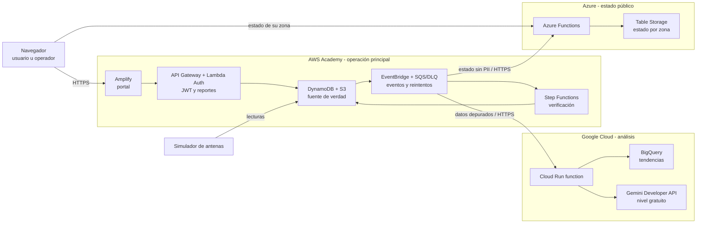
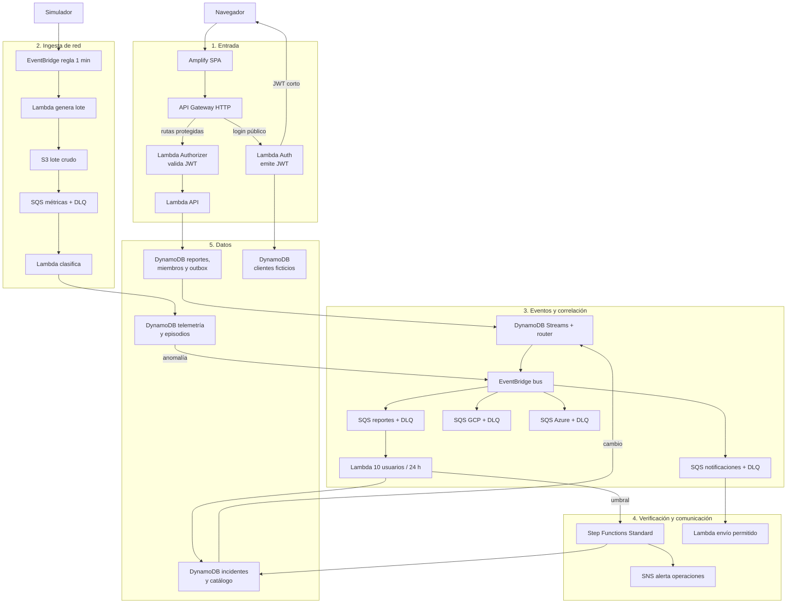
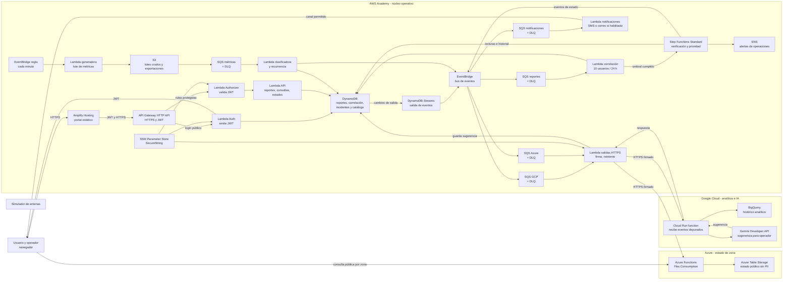

# Arquitectura de solución v1 — Red TeleCorp

**Estado:** diseño propuesto, aún sin despliegue ni prueba de permisos. **Nubes:** AWS Academy (núcleo operativo), Google Cloud/GCP (analítica e IA) y Azure (proyección pública de estado). **Fuente funcional:** [puntos-dolor-cliente.md](puntos-dolor-cliente.md). **Evaluación:** [rubrica-hackathon.md](rubrica-hackathon.md). Fecha: 14 de noviembre de 2026.

Este Markdown es una nota de diseño para el equipo. Para la entrega por Canvas, usar el **diagrama de arquitectura** (por ejemplo, el SVG/PNG) junto con el video y el repositorio; el enunciado prohíbe adjuntar un informe.

## Decisión principal

AWS conserva la **fuente de verdad** de reportes, incidentes, historial, clientes ficticios y telemetría reciente. GCP recibe solo eventos sin datos personales para tendencias y para que la IA sugiera una síntesis de investigación. Azure conserva una copia mínima del estado de incidencias por zona y la expone aunque el portal principal no responda. Las tres nubes realizan trabajo visible y están unidas por eventos HTTPS. Ninguna instancia de cómputo necesita permanecer encendida.

No usamos RDS, EC2, ECS, Airflow, WAF, NAT Gateway ni Firehose en esta primera versión. DynamoDB on-demand se ajusta mejor a los accesos definidos y a una carga variable; [AWS lo describe como modo serverless que se escala según demanda](https://docs.aws.amazon.com/amazondynamodb/latest/developerguide/on-demand-capacity-mode.html). Varias **tablas** responden a patrones de consulta distintos; no se crean bases adicionales solo por multiplicar servicios.

## Vista por capas: tres nubes

El panorama muestra quién hace cada trabajo. Se puede abrir también como [imagen PNG](arquitectura-v1-panorama.png) o [SVG](arquitectura-v1-panorama.svg) desde una tableta.

## Interior de AWS: recorrido operativo

Esta vista separa acceso, ingesta, procesamiento y automatización. Está disponible como [PNG](arquitectura-v1-aws.png) o [SVG](arquitectura-v1-aws.svg).

## Diagrama técnico completo

Las flechas de DynamoDB Streams representan los **eventos de salida** creados junto con los cambios de negocio; el enrutador Lambda que los publica en EventBridge se explica abajo. `S3 → SQS` usa una notificación de objeto nuevo. El diagrama omite ese Lambda enrutador y las tablas individuales para mantener legible la vista general.

## Arquitectura por capas

| Capa | Servicio y función | Salida / límite claro |
| --- | --- | --- |
| 1. Acceso y frontend | Navegador → **Amplify Hosting** con una SPA estática para usuarios y operadores. `POST /auth/login` en **API Gateway HTTP API** llama a **Lambda Auth**, que verifica una cuenta ficticia y emite un JWT breve. Las demás rutas pasan por **Lambda Authorizer**, que valida firma, `iss`, `aud`, `exp` y rol. [API Gateway admite Lambda authorizers en HTTP API](https://docs.aws.amazon.com/apigateway/latest/developerguide/http-api-lambda-authorizer.html). | Sin Cognito. El navegador nunca contiene la clave de firma ni claves de nube. CORS, rate limiting y autorización de cada ruta se prueban. |
| 2. API de negocio | Lambdas `CreateReport`, `GetMyReports`, `GetReport`, `ListZoneIncidents`, `ChangeStatus`, `GetDashboard`. `CreateReport` valida cliente ficticio, número, zona, servicio, tiempo y clave de idempotencia; devuelve éxito **después** de guardar. `ChangeStatus` exige operador y deja historial. | Una llamada HTTP rápida; la correlación, notificación e IA son asíncronas. |
| 3. Ingesta de antenas | Regla programada de **EventBridge** cada minuto → Lambda simuladora → objeto S3 con las 30 lecturas del minuto. S3 avisa a SQS; Lambda clasificadora procesa cada lectura en DynamoDB. Una fuente real futura podría entregar el mismo formato al API. | S3 conserva el lote original para reproducirlo si falla el procesamiento. No se crea una Lambda permanentemente encendida. |
| 4. Eventos y amortiguación | El guardado de un reporte o estado escribe un **outbox** en la misma transacción. DynamoDB Streams activa una Lambda enrutadora que publica `report.created`, `incident.updated`, etc. en **EventBridge**. Reglas envían a SQS independientes para correlación, notificaciones, GCP y Azure; cada una tiene DLQ. | Un fallo en GCP/Azure no bloquea el registro ni la atención en AWS. El outbox y las DLQ permiten inspección y reproceso. |
| 5. Correlación y automatización | Lambda correlación consulta reportantes por zona/servicio y ventana estricta de 24 h. Al detectar 10 usuarios únicos crea un solo incidente `sospechado` y arranca **Step Functions Standard**. El flujo consulta antenas asociadas, registra evidencias, calcula prioridad, alerta a operaciones y deja el caso para confirmación humana. [Standard ofrece historial de ejecución](https://docs.aws.amazon.com/step-functions/latest/dg/welcome.html). | La IA y las métricas son evidencia; solo un operador confirma o descarta la falla colectiva. Step Functions se ejecuta por incidente, no por cada lectura. |
| 6. Comunicación | SNS avisa al equipo operativo. Una Lambda separada prepara la intención por usuario/hito y usa **SNS SMS o SES correo solo si el laboratorio permite el envío**. El portal siempre muestra el estado. | El canal externo es una prueba de permisos obligatoria para cubrir D06; no se afirma entrega real antes de probarlo. [SNS SMS puede estar limitado por sandbox](https://docs.aws.amazon.com/sns/latest/dg/sms_sending-overview.html). |
| 7. Google Cloud | Una **Cloud Run function** HTTPS recibe datos depurados. Inserta revisiones de incidencias y agregados en **BigQuery**. Al surgir un colectivo, consulta episodios históricos comparables por zona/servicio/anomalía y da esos hechos a **Gemini Developer API (nivel gratuito)** para proponer una hipótesis y pasos de verificación con referencias a los eventos usados. AWS guarda la sugerencia como dato auxiliar y el operador decide. [BigQuery es serverless](https://docs.cloud.google.com/bigquery/docs/introduction); [Gemini Developer API tiene un nivel gratuito con modelos y límites seleccionados](https://ai.google.dev/gemini-api/docs/pricing). Véase la [decisión de IA](decision-ia.md). | A GCP van `zone_id`, tipo de servicio, fechas, prioridad, clasificación de antenas y conteos; no nombre, teléfono, número de servicio ni descripción cruda. IA no fija estados ni prioridad. |
| 8. Azure | Una **Azure Function Flex Consumption**, con `always ready = 0`, recibe proyecciones de `incident.updated` y las guarda en **Azure Table Storage**. Otra ruta de la misma Function entrega estado público por zona con `last_synced_at`. [Flex Consumption escala a cero](https://learn.microsoft.com/en-us/azure/azure-functions/flex-consumption-plan). | Consulta independiente del API de AWS. Es una proyección eventualmente consistente, no una segunda fuente de verdad ni un failover completo del portal. |
| 9. Datos y seguridad | **DynamoDB** para operación; **S3** para lotes crudos/exportaciones; **BigQuery** para analítica; **Azure Table Storage** para estado público. **SSM Parameter Store SecureString** guarda las claves de firma de las salidas HTTPS, si `LabRole` puede leerlas. [SecureString cifra los valores con KMS](https://docs.aws.amazon.com/systems-manager/latest/userguide/parameter-store-setting-up.html). | Sin secretos en código o navegador. Firmar cuerpo + timestamp + identificador para impedir alteraciones/repetición; GCP y Azure validan con sus secretos correspondientes. |

### Rutas mínimas del portal

| Ruta | Uso | Consulta principal |
| --- | --- | --- |
| `POST /auth/login` | Acceso de usuario u operador ficticio; devuelve JWT de corta duración. | `CustomerProfiles` guarda ambos tipos de cuenta con contraseña protegida por hash y sal. Esta ruta no usa el authorizer. |
| `POST /reports` | Crear reporte; requiere identidad del usuario y clave de idempotencia. | Transacción en Reports, CorrelationMembers y Outbox. |
| `GET /reports/mine` y `GET /reports/{id}` | Consultar reportes propios, estado e historial. | GSI-User y PK de Reports; verificar propiedad en backend. |
| `GET /ops/incidents?zone_id=...` | Cola del operador por zona y prioridad. | GSI-ZoneOpen de Incidents. |
| `PATCH /ops/reports/{id}/status` y `PATCH /ops/incidents/{id}/status` | Cambiar estado con motivo y actor. | Actualización condicional + historial + Outbox. |
| `GET /ops/trends?period=7d|30d` | Zonas, antenas y tipos más frecuentes. | Agregados de BigQuery por medio del backend; si GCP falla, informar que la analítica está atrasada. |
| `GET /zones/{zone_id}/status` en Azure | Estado público de zona. | Azure Table Storage; muestra `last_synced_at`. |

### Flujo exacto de un reporte

1. El usuario envía `POST /reports` con identidad ficticia, número de servicio, zona, hora, tipo y descripción; API Gateway autentica y Lambda valida.
2. Una transacción DynamoDB escribe `Reports/META`, la clave de idempotencia, el elemento de `CorrelationMembers` y un evento `Outbox`. Si la transacción falla, la API **no** responde «recibido». Las transacciones son atómicas dentro de DynamoDB, según [AWS](https://docs.aws.amazon.com/amazondynamodb/latest/developerguide/transaction-apis.html).
3. El cambio de Outbox llega por DynamoDB Streams al enrutador, que publica en EventBridge. Si el enrutador falla, se configura destino de fallo y conciliación de eventos pendientes; [AWS advierte que un registro de Stream puede descartarse tras agotar reintentos o edad](https://docs.aws.amazon.com/lambda/latest/dg/services-dynamodb-errors.html).
4. SQS amortigua los reportes. Lambda correlación consulta las claves de los dos días UTC involucrados con lectura **fuertemente consistente** y paginación, elimina clientes repetidos y aplica `ahora - 24 h < occurred_at <= ahora`. No basa el disparo en un GSI, que solo admite lectura eventual [según AWS](https://docs.aws.amazon.com/amazondynamodb/latest/APIReference/API_Query.html).
5. La creación condicional del puntero de grupo impide dos incidentes activos para la misma zona/servicio. Los reportes posteriores se vinculan. Un incidente cerrado solo puede reabrirse con reportes **posteriores a su cierre**, para no duplicarlo por mensajes atrasados.
6. Step Functions verifica antenas y registra evaluación/prioridad. Emite evento de estado; colas separadas atienden mensajes, analítica/IA y la copia de Azure. El operador confirma, descarta, restablece o cierra desde el portal.

### Flujo exacto de una antena

`EventBridge regla de 1 minuto → Lambda generadora → S3 lote JSON comprimido → notificación S3 → SQS métricas → Lambda clasificadora → Telemetry + episodio → EventBridge si hay anomalía/recurrencia`.

Se usa la **regla programada de EventBridge** como primera opción del laboratorio. EventBridge Scheduler suele requerir un rol de ejecución propio para invocar el destino; esto choca con «no crear roles» hasta verificar un rol compatible. EventBridge permite invocar Lambda o SQS desde una regla mediante [política basada en recurso](https://docs.aws.amazon.com/eventbridge/latest/userguide/eb-use-resource-based.html), sujeto a los permisos efectivos del laboratorio. No hace falta Kinesis, Firehose ni un servicio de ingesta adicional para 30 lecturas por minuto; se reconsidera después de medir carga real.

## Diseño de datos: consultas primero, claves después

**Regla de diseño:** la PK agrupa lo que se consulta junto; la SK ordena o acota el rango. No usar `sexo#fecha#usuario` como única PK: una categoría de baja cardinalidad puede concentrar tráfico y los datos personales no deben ir en claves legibles. AWS recomienda distribuir actividad entre particiones y [usar SK compuestas para rangos jerárquicos](https://docs.aws.amazon.com/amazondynamodb/latest/developerguide/bp-partition-key-design.html). `#` en los ejemplos es un separador de cadena, no un operador especial de DynamoDB. Fechas en UTC e ISO 8601 mantienen el orden lexicográfico.

| Tabla AWS | PK / SK propuestas | Consulta que evita `Scan` | Retención |
| --- | --- | --- | --- |
| `CustomerProfiles` | `PK=CUSTOMER#<id>` u `OPERATOR#<id>`, `SK=PROFILE` | Login por `GetItem` de la cuenta ficticia, hash/sal de contraseña, rol; para clientes también número de servicio, contacto y preferencias ficticias. | Datos de demo, borrado al cerrar proyecto. |
| `NetworkCatalog` | `PK=ZONE#<id>` o `ANT#<id>`; `SK=META` o `LINK#<otro-id>` | Ver tipo de zona y todas sus antenas; consultar zonas cubiertas por una antena. Los enlaces se duplican en ambas direcciones de forma controlada. | Catálogo de demo. |
| `Reports` | Reporte: `PK=REPORT#<uuid>`, `SK=META` o `HIST#<UTC>#<event_id>`. Solicitud idempotente en la misma tabla: `PK=REQUEST#<customer_id>#<idempotency_key>`, `SK=META`, con `report_id` de respuesta. | Reporte + historial por PK. **GSI-User:** `USER#<id>` / `RECV#<UTC>#<report_id>` lista mis reportes. **GSI-ZoneState:** `ZONE#<id>#STATE#<estado>` / `RECV#<UTC>#<report_id>` lista de trabajo. Solo el `META` del reporte lleva atributos de GSI. | 1 año propuesto. |
| `CorrelationMembers` | `PK=ZONE#<id>#SERVICE#<tipo>#DAY#<YYYYMMDD>`; `SK=T#<occurred_at>#USER#<id>#REPORT#<id>` | `Query` consistente de **hoy y ayer UTC**, con límite temporal; deduplicar `customer_id` en código. El PK por día evita una partición eterna por zona. | TTL 48 h; historial completo sigue en Reports. |
| `Incidents` | `PK=INC#<uuid>`; `SK=META`, `HIST#<UTC>#<event_id>`, `LINK#<report_id>` y `NOTIFY#<customer_id>#<hito>`. Puntero: `PK=GROUP#<zone_id>#<service>`, `SK=ACTIVE` | Incidente + historial + reportes vinculados; `GetItem`/actualización condicional del grupo activo. **GSI-ZoneOpen:** `ZONE#<id>#OPEN` / `P#<prioridad>#<detected_at>#<id>` para cola operativa por zona. | 1 año propuesto. |
| `Telemetry` | Lectura: `PK=ANT#<id>#DAY#<YYYYMMDD>`, `SK=T#<measured_at>`; episodio: `PK=ANT#<id>`, `SK=EP#<start_at>`; estado: `SK=OPEN` | Lecturas recientes de una antena en dos días; episodios de últimos siete días; estado de episodio con `GetItem`. | Lecturas 30 días; episodios/agregados 1 año. |
| `Outbox` | `PK=EVENT#<uuid>`; GSI de conciliación `PENDING#<YYYYMMDD>` / `<created_at>#<event_id>` | Publicar solo eventos nacidos de transacciones confirmadas; localizar pendientes sin `Scan`. | Hasta confirmar publicación y periodo de auditoría. |

**Ejemplo de ventana:** a las `2026-11-14T10:00:00Z`, consultar `CorrelationMembers` de `DAY#20261113` desde `T#2026-11-13T10:00:00Z` (exclusivo) y de `DAY#20261114` hasta la hora actual. Se cuentan `customer_id` únicos. Un reporte de hace exactamente 24 horas queda fuera. Si un mismo cliente reportó ayer y hoy, sigue contando una sola vez.

**Concurrencia y costo:** los reportes guardados no se leen uno por uno de toda la tabla. Al no haber incidente activo, la correlación consulta las dos particiones del grupo; al crearlo, los reportes siguientes solo se vinculan. Para una zona muy concurrida se añadirían *shards* calculados a partir de `customer_id` y consultas paralelas; no se introducen en la demo sin medir particiones calientes. Los GSI aceleran listados pero no sirven para decidir el décimo usuario por su consistencia eventual.

**Otros almacenes:** en S3 `telemetry/raw/YYYY/MM/DD/HH/mm/<batch_id>.json.gz` contiene el lote original y `exports/` solo archivos generados bajo solicitud; los reportes privados permanecen en DynamoDB. En **BigQuery**, `incident_events` se particiona por fecha y se agrupa por zona/servicio; cada fila lleva `event_id` para deduplicar reenvíos. En **Azure Table Storage**, `PartitionKey=ZONE#<id>` y `RowKey=ACTIVE#<service>` guardan estado, prioridad, resumen público y `last_synced_at`, sin PII; [PartitionKey + RowKey identifican la entidad](https://learn.microsoft.com/en-us/rest/api/storageservices/understanding-the-table-service-data-model).

## Fiabilidad, seguridad y costos que hay que probar

- Cada SQS principal lleva DLQ, alarma de mensajes antiguos/errores y procedimiento de reproceso. Los consumidores aceptan duplicados y usan `event_id`/condiciones DynamoDB; **DLQ significa cola de mensajes fallidos**. AWS recomienda configurar reintentos y respuestas parciales para Lambda con [SQS](https://docs.aws.amazon.com/lambda/latest/dg/services-sqs-configure.html).
- DynamoDB y S3 son servicios gestionados con redundancia entre zonas de disponibilidad, pero eso no sustituye respaldos ni una prueba de restauración. Comprobar si el laboratorio permite recuperación a un punto en el tiempo para DynamoDB y versionado de S3; [AWS describe su comportamiento multi-AZ](https://docs.aws.amazon.com/pdfs/wellarchitected/latest/reliability-pillar/wellarchitected-reliability-pillar.pdf).
- La autenticación del portal usa una clave JWT distinta de las claves de conexión entre nubes. Lambda Auth y **Lambda Authorizer** leen la clave desde SSM SecureString con `LabRole`; se configura el authorizer tipo Lambda de API Gateway, **no** el authorizer JWT nativo. El token dura 15 minutos, se conserva solo en memoria del navegador y contiene `sub`, rol, `iss`, `aud`, `exp` y `jti`, nunca PII. El validador fija el algoritmo permitido y comprueba firma, emisor, audiencia, vencimiento y rol. Se limitan los intentos de login y se desactiva la caché del authorizer en v1 para no reutilizar un permiso entre rutas; [AWS advierte sobre el alcance de las respuestas simples en caché](https://docs.aws.amazon.com/apigateway/latest/developerguide/http-api-lambda-authorizer.html). Es autenticación de **prototipo con cuentas ficticias**, no de abonados reales.
- Todas las llamadas entre nubes usan HTTPS. Para el prototipo, AWS firma con HMAC un cuerpo, hora e ID; la función receptora rechaza firma inválida y reenvíos fuera de una ventana corta. Dentro de la ventana, los consumidores usan `event_id` o revisión para no aplicar dos veces un mismo cambio. La clave de AWS vive en SSM SecureString; el verificador usa almacén de secretos de su propia nube. GCP recomienda [federación de identidad para llamadas desde fuera de Google Cloud](https://docs.cloud.google.com/run/docs/authenticating/service-to-service) como evolución más fuerte. La autenticación por clave de función **por sí sola** no es suficiente según [Microsoft](https://learn.microsoft.com/en-us/azure/azure-functions/security-concepts).
- El proveedor de IA, la tabla analítica y la copia pública no reciben datos personales. Gemini Developer API recibe hechos estructurados y hasta unos pocos episodios comparables recuperados de BigQuery; devuelve una **hipótesis** y pruebas recomendadas. Si no hay evidencia comparable, se marca «sin antecedentes suficientes». La hipótesis se muestra con eventos fuente y revisión humana. No se llama al modelo por cada lectura o reporte: solo por incidente colectivo o petición del operador. El nivel gratuito permite a Google usar el contenido para mejorar sus productos; por eso la demo usa datos sintéticos o depurados [según la información oficial de precios](https://ai.google.dev/gemini-api/docs/pricing).
- Control de costos: Lambda/Functions escalan con eventos; DynamoDB on-demand; S3 por lotes y ciclo de vida; BigQuery con particiones, límites de consulta y agregados; IA bajo demanda; Azure Functions `always ready = 0`. No se afirma precio fijo sin conocer región, cuotas ni crédito de las cuentas.
- Si GCP o Azure no responden, sus colas acumulan eventos y sus DLQ guardan fallos; el estado en AWS sigue siendo el válido. El endpoint de Azure informa `last_synced_at` para que un usuario detecte una proyección atrasada.

## Verificación obligatoria antes de implementar

| Orden | Prueba corta | Por qué puede bloquear el diseño |
| --- | --- | --- |
| 1 | En AWS Academy, inspeccionar `LabRole`: confianza para **Lambda** y **Step Functions**, `iam:PassRole`, `states:CreateStateMachine/StartExecution`, lectura SQS/Streams, escritura DynamoDB/S3/EventBridge, `ssm:GetParameter` y `kms:Decrypt`. | [Step Functions exige rol de ejecución](https://docs.aws.amazon.com/step-functions/latest/dg/procedure-create-iam-role.html) y pasarlo requiere [iam:PassRole](https://docs.aws.amazon.com/step-functions/latest/dg/security_iam_troubleshoot.html). Si `LabRole` no tiene confianza/permiso y no se puede crear otro, esta parte requiere que el docente habilite un rol compatible; el diagrama no se considera desplegable aún. |
| 2 | Desplegar SPA estática en Amplify, `POST /auth/login` → Lambda Auth y Lambda Authorizer en rutas protegidas; probar un usuario y un operador ficticios. | Confirmar permisos de Amplify, API Gateway, Lambda, SSM/KMS y `LabRole`. Crear/validar JWT propios exige probar firma, vencimiento, audiencia, rol y rechazo de tokens alterados; no crear roles IAM. |
| 3 | Probar la regla programada de EventBridge→Lambda, S3→SQS y EventBridge→SQS con políticas de recurso permitidas. | Evita depender de EventBridge Scheduler o de roles que el equipo no pueda crear. |
| 4 | Crear el proyecto GCP: Cloud Run function, BigQuery, clave de Gemini Developer API y secreto receptor; una llamada firmada desde AWS con datos ficticios. | Confirmar acceso al modelo gratuito, límites, región, permisos y facturación de los demás servicios antes de basar la demo en IA. Vertex AI queda como alternativa solo si se verifica presupuesto. |
| 5 | Crear la suscripción Azure: Function Flex Consumption (`always ready = 0`) + Table Storage + secreto receptor; POST y GET de una zona ficticia. | Confirma acceso del equipo y salud de **su** región/suscripción. El [estado público de Azure](https://azure.status.microsoft/en-us/status) no sustituye esa prueba. |
| 6 | Verificar un envío real de correo o SMS a un destino de prueba; si AWS SNS/SES está bloqueado, evaluar un canal permitido, como Azure Communication Services Email (requiere dominio habilitado). | D06 pide comunicación por correo y/o celular. El estado en portal ayuda pero no demuestra por sí solo ese canal. [Azure exige dominio conectado y verificado](https://learn.microsoft.com/en-us/azure/communication-services/quickstarts/email/send-email). |
| 7 | Ejecutar 30 antenas/minuto y 1000 reportes/10 minutos, revisar conteo, latencia, DLQ y costo. | Valida S11 y evita afirmar escalabilidad o cero pérdidas sin medición. |

## Correspondencia con la rúbrica

| Criterio | Evidencia planificada en v1 |
| --- | --- |
| Dolores del cliente (3) | Portal, umbrales, correlación, estados, historial, prioridad, recurrencia, comunicaciones, analítica y carga, trazados a D01–D13. |
| Persistencia y alta disponibilidad (2) | DynamoDB/S3, outbox, colas/DLQ, pruebas de recuperación; proyección Azure como lectura pública adicional. |
| Step Functions (2) | Máquina Standard para verificación y priorización de un colectivo; **sujeta al rol del lab**. |
| Dos o más nubes (3) | AWS + GCP + Azure con flujos reales; la puntuación solo se demuestra con despliegue. |
| Arquitectura (3) | Este diagrama, capas, claves, flujos, seguridad, fallos y costos. |
| Pitch (2) | Se preparará después; máximo cinco minutos. |
| Completamente serverless (2) | Amplify/API/Lambda/Dynamo/S3/SQS/EventBridge/SFN; Cloud Run/BigQuery/Gemini API; Azure Functions/Table. Sin cómputo propio permanente. |
| IA (3) | Hipótesis y pasos de verificación sugeridos por Gemini Developer API a partir de hechos actuales y antecedentes comparables de BigQuery, visibles al operador; no sustituye reglas deterministas. |

**Estado final de esta versión:** arquitectura documentada. Disponibilidad, permisos, costos, seguridad efectiva, rendimiento y puntos de rúbrica **pendientes de validar en las cuentas reales**.
