# Arquitectura v2: nombres de AWS y flujo de IA

Esta versión toma los nombres de [aws/infra/serverless.yml](aws/infra/serverless.yml). Es un **diseño declarativo**: no hay handlers ni despliegue aún. GCP y Azure conservan las funciones de la [arquitectura v1](arquitectura-solucion-v1.md). Para explicar el sistema se recomienda el [panorama editable](arquitectura-v2-panorama.mmd), con [PNG](arquitectura-v2-panorama.png) y [SVG](arquitectura-v2-panorama.svg). Para editar cada recurso AWS está el [diagrama técnico](arquitectura-solucion-v2.mmd), con [PNG](arquitectura-solucion-v2.png) y [SVG](arquitectura-solucion-v2.svg).

```mermaid
flowchart LR
  U["Navegador"] --> A["Amplify Hosting"] --> G["API Gateway HTTP red-telecorp-dev-api-http"]
  G -->|login publico| L["AutenticarUsuario"] --> C["CustomerProfiles"]
  L -->|JWT 15 min| U
  G -->|rutas protegidas| J["AutorizarJWT"] --> B["Lambdas API"]
  S["SSM SecureString"] --> L
  S --> J
  B --> D["Reports / Incidents / NetworkCatalog"]
  D --> O["Outbox Streams"] --> R["EnrutadoraDeOutbox"] --> E["OperacionesBus"]
  E --> Q["ColaReportes + DLQ"] --> K["CorrelacionadoraDeReportes"] --> F["VerificarIncidente Step Functions"]
  F --> V["VerificadoraDeEvidencias"] --> P["CalculadoraDePrioridad"] --> N["AlertadoraDeOperaciones"] --> T["SNS"]
  E --> QG["ColaGCP + DLQ"] --> PG["PublicadoraHaciaGCP"] --> CR["Cloud Run function"] --> BQ["BigQuery"]
  CR --> AI["Gemini Developer API"] --> CR -->|sugerencia| PG --> D
  E --> QA["ColaAzure + DLQ"] --> PA["PublicadoraHaciaAzure"] --> AZ["Azure Functions + Table Storage"]
```

## Cambios concretos en el diagrama anterior

| Rótulo anterior | Rótulo v2 |
| --- | --- |
| Lambda Auth | `AutenticarUsuario` |
| Lambda Authorizer | `AutorizarJWT` |
| Lambda API | `CrearReporte`, `ListarMisReportes`, `ObtenerReporte`, `ListarIncidentesZona`, `CambiarEstadoReporte`, `CambiarEstadoIncidente`, `ObtenerTendencias`, `ObtenerSugerenciaIA` |
| Lambda generadora lote de métricas | `GeneradoraDeMetricasYLotes` |
| Lambda clasificadora y recurrencia | `ClasificadoraDeMetricas` |
| DynamoDB Streams + router | `Outbox` Streams → `EnrutadoraDeOutbox` |
| Lambda 10 usuarios / 24 h | `CorrelacionadoraDeReportes` |
| Step Functions Standard | `VerificarIncidente`, con `VerificadoraDeEvidencias` → `CalculadoraDePrioridad` → `AlertadoraDeOperaciones` |
| Lambda envío permitido | `NotificadoraDeClientes` |
| Lambda salidas HTTPS | `PublicadoraHaciaGCP` y `PublicadoraHaciaAzure` |
| EventBridge bus | `OperacionesBus` |

El acceso tiene **dos Lambdas distintas**: `POST /auth/login` llama a `AutenticarUsuario` sin authorizer; las otras rutas invocan `AutorizarJWT` antes de la Lambda de negocio. Ambas leen la clave JWT de SSM, nunca del navegador. La autorización de propiedad de un reporte y del rol de operador también debe comprobarse en las Lambdas API.

## IA demostrable

Al crear un incidente colectivo, `OperacionesBus` envía un evento depurado a `ColaGCP`. `PublicadoraHaciaGCP` lo entrega a Cloud Run; esta consulta antecedentes en BigQuery y pide a **Gemini Developer API** una hipótesis y pasos de verificación. La sugerencia vuelve a AWS, queda en `Incidents` y `ObtenerSugerenciaIA` la muestra al operador. La IA no decide el estado ni la prioridad. [Decisión y límites de IA](decision-ia.md).

Un chatbot general no es necesario para el criterio R08: la sugerencia específica de un incidente resuelve un dolor del reto y es más fácil de demostrar. **Bedrock con Nova Micro** es una posible alternativa de chat si `LabRole` permite `bedrock:InvokeModel`, el modelo está disponible en la región y se aprueba el costo; el archivo actual no afirma que Bedrock esté habilitado ni lo usa como dependencia. [Acceso a modelos](https://docs.aws.amazon.com/bedrock/latest/userguide/model-access.html), [modelo Nova Micro](https://docs.aws.amazon.com/nova/latest/userguide/what-is-nova.html), [precios Bedrock](https://aws.amazon.com/bedrock/pricing/).

## Revisión de encaje y límites del `serverless.yml`

- **Encajan** API Gateway HTTP, Lambda Authorizer, DynamoDB, S3, SQS/DLQ, EventBridge, Step Functions Standard, SNS y SSM en el flujo funcional. `Outbox` es la única tabla con Streams; el evento de negocio sale de la transacción y se publica una vez procesado por `EnrutadoraDeOutbox`.
- **Step Functions y LabRole**: el rol existente necesita confianza para `states.amazonaws.com` y permisos de invocación de las tres Lambdas. El archivo no crea otro rol; si el laboratorio no lo permite, este recurso bloqueará el despliegue y habrá que pedir un rol habilitado por el docente.
- **SSM**: los tres parámetros de firma se nombran pero no se crean con valores ficticios en Git. Deben cargarse por un medio seguro y `LabRole` debe poder leerlos.
- **Login**: falta configurar límites de solicitudes y bloqueo temporal por intentos fallidos. `AutorizarJWT` tiene caché desactivada; cada ruta de negocio debe aplicar su comprobación de rol y propiedad.
- **Amplify** aloja el portal, pero no aparece como recurso del `serverless.yml`: requiere conectar el repositorio y validar que AWS Academy permita usarlo. Su nombre propuesto es `red-telecorp-portal`.
- **SNS a clientes** y correo/SMS requieren comprobar permisos, sandbox y destino de prueba. `NotificadoraDeClientes` existe como contrato; la entrega externa sigue pendiente.
- **GCP y Azure** mantienen sus recursos fuera de esta plantilla. Las URLs de integración y el origen CORS son marcadores; no usar los dominios `example.invalid` al desplegar.
- **Sin código ni permisos probados**: `serverless print` valida la configuración, pero `serverless package/deploy` no puede concluir hasta que existan los handlers y se sustituyan los marcadores. El Framework v3 permite validar sin iniciar sesión; `org: xxxx` queda comentado porque cuatro caracteres no cumplen su esquema y activar Dashboard requiere una organización real.
